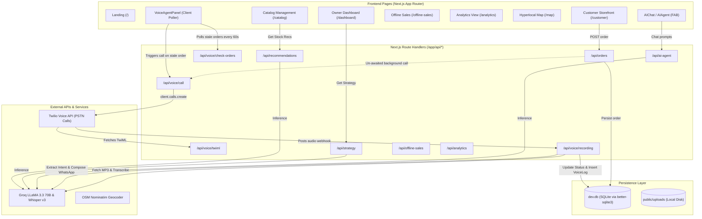

# Retailytics: Project Architecture & AI Workforce Modernization Brief

> **Document Version:** 1.0.0  
> **Repository:** `retailytics`  
> **Status:** Current State Audit & Architectural Blueprint (No code modified)

---

## 1. Executive Summary & Current Architecture

**Retailytics** is a hyperlocal retail intelligence and order fulfillment platform tailored for local Indian merchants (Kirana stores, pharmacies, electronics shops, etc.). It combines a customer storefront, merchant analytics dashboard, LLM-powered advisory chat, and a Twilio PSTN voice agent that calls store owners to confirm pending orders.

### 1.1 Technology Stack

| Layer | Technologies | Details |
|---|---|---|
| **Frontend** | Next.js 16.1.6 (App Router), React 19.2.3, Tailwind CSS v4 | Client components with polling intervals and Tailwind styling |
| **Backend** | Next.js Route Handlers (`app/api/*`) | TypeScript server endpoints running in Node.js runtime |
| **Database** | SQLite (`dev.db`) | Hybrid access: Prisma 7.5.0 + raw `better-sqlite3` connections |
| **LLM & Speech AI** | Groq SDK (`groq-sdk` v1.1.1) | `llama-3.3-70b-versatile` (advisory, intent parsing, messaging)<br>`whisper-large-v3` (audio transcription) |
| **Telephony** | Twilio SDK (`twilio` v5.13.0) | Programmable Voice, TwiML generation, recording transcription |
| **Payments** | `qrcode` (v1.5.4) | UPI deep-link generation (`upi://pay?pa=...`) and QR rendering |
| **Geocoding** | OpenStreetMap Nominatim API | Hyperlocal coordinates lookup for customer addresses |
| **Storage** | Local Filesystem (`public/uploads`) | Direct file writes for product images |

### 1.2 High-Level Architecture Diagram



---

## 2. API Route Inventory

The repository contains **25 Next.js API route handlers** under `app/api/`:

| Method(s) | Endpoint | Purpose & Description | Data Stores / External APIs Used |
|---|---|---|---|
| `POST` | `/api/ai-agent` | Context-aware merchant AI chat advisor. Ingests business profile, product inventory, order counts, offline stats, and dynamic seasonal context; invokes Groq LLaMA 3.3. | `better-sqlite3`, Groq `llama-3.3-70b-versatile` |
| `GET` | `/api/analytics` | Computes revenue, total order count, items sold, average order value, order status distribution, and top product revenues for a merchant. | `better-sqlite3` (`Order`, `OrderItem`, `Product`) |
| `POST` | `/api/business` | Onboards a new merchant business. Ensures owner User exists, inserts `Business` record with geocoordinates, operating hours, and contact. | `better-sqlite3` (`User`, `Business`) |
| `GET` | `/api/business/latest` | Returns either the single most recently registered business or all registered businesses (`?all=true`). | `better-sqlite3` (`Business`) |
| `GET`, `PATCH` | `/api/customer-messages` | `GET`: Fetches WhatsApp customer notification logs.<br>`PATCH`: Marks a notification message status as `sent`. | `better-sqlite3` (`CustomerMessage`, `Order`, `Business`) |
| `GET` | `/api/customer-messages/by-phone` | Fetches customer notification history for a specific customer phone number. | `better-sqlite3` (`CustomerMessage`, `Order`) |
| `GET`, `POST` | `/api/customer-profile` | `GET`: Looks up customer by phone or returns all (`?all=true`).<br>`POST`: Upserts a customer name, phone, address, and coordinates. | `better-sqlite3` (`CustomerProfile`) |
| `GET` | `/api/geocode` | Geocodes a street address/landmark to lat/lng coordinates in Madhya Pradesh. | OpenStreetMap Nominatim API |
| `GET`, `POST`, `DELETE` | `/api/offline-sales` | Records walk-in offline shop transactions, calculates summary statistics, and deletes records. | `better-sqlite3` (`OfflineSale`) |
| `GET`, `POST`, `PATCH` | `/api/orders` | `GET`: Lists orders with line items for a business.<br>`POST`: Inserts a new customer order and fires background owner voice call.<br>`PATCH`: Updates order status (`pending`, `confirmed`, `delivered`, `cancelled`). | `better-sqlite3`, Twilio API (via background `triggerCallForOrder`) |
| `GET` | `/api/orders/customers` | Searches customer orders by phone or customer name. | `better-sqlite3` (`Order`, `OrderItem`, `Product`, `Business`) |
| `GET`, `POST`, `PATCH`, `DELETE` | `/api/products` | Full CRUD operations for merchant catalog products (name, price, stock, image). | `better-sqlite3` (`Product`, `Business`) |
| `GET` | `/api/products/all` | Returns all products across all shops in randomized order for consumer marketplace discovery. | `better-sqlite3` (`Product`, `Business`) |
| `GET` | `/api/recommendations` | Generates 5 stock restocking recommendations based on shop inventory and hardcoded seasonal/macro signals. | `better-sqlite3`, Groq `llama-3.3-70b-versatile` |
| `GET` | `/api/shops` | Lists all merchant shops with live product counts and geocoordinates for map rendering. | `better-sqlite3` (`Business`, `Product`) |
| `GET` | `/api/strategy` | Generates 6 categorized strategic recommendations (`STOCK_UP`, `REMOVE`, `PRICING`, `MARKETING`, `EXPANSION`, `ALERT`) using current sales and inventory snapshots. | `better-sqlite3`, Groq `llama-3.3-70b-versatile` |
| `GET` | `/api/upi-qr` | Constructs UPI payment URI (`upi://pay?pa=...`) and renders base64 PNG QR code. | `qrcode` |
| `POST` | `/api/upload` | Multipart image upload for product photos. Validates type/size (max 5MB) and saves to `public/uploads/`. | Local filesystem (`fs/promises`) |
| `POST` | `/api/voice/call` | Directly triggers an outbound Twilio phone call to the shop owner with order details. Updates `notified = 1`. | Twilio Voice API, `better-sqlite3` (`Order`) |
| `POST` | `/api/voice/call-status` | Twilio status callback webhook logging terminal states (`completed`, `no-answer`, `failed`, `busy`). | Console logger |
| `GET`, `POST` | `/api/voice/check-orders` | `GET`: Queries pending orders created > 1 minute ago that have `notified = 0`.<br>`POST`: Marks `notified = 1` for an order ID. | `better-sqlite3` (`Order`, `Business`, `OrderItem`, `Product`) |
| `POST` | `/api/voice/recording` | Twilio voice recording callback. Downloads audio, transcribes with Groq Whisper, parses owner intent (CONFIRM/CANCEL), updates order status, generates customer message, stores `VoiceLog`, deletes audio on Twilio. | Twilio REST API, Groq Whisper v3, Groq LLaMA 3.3, `better-sqlite3` |
| `GET` | `/api/voice/status` | Returns recent `VoiceLog` records joined with Order info for the owner dashboard. | `better-sqlite3` (`VoiceLog`, `Order`) |
| `GET`, `POST` | `/api/voice/twiml` | Returns XML TwiML containing `<Say>` prompt and `<Record>` directive to capture owner verbal response. | None (pure TwiML XML generator) |
| `POST` | `/api/voice/webhook` | Alternative webhook for Vapi.ai voice integration end-of-call report processing. | Groq `llama-3.3-70b-versatile`, `better-sqlite3` |

---

## 3. The Prisma Schema vs. Actual Database Reality

A critical discovery in the codebase is a **substantial drift** between the declared Prisma schema (`prisma/schema.prisma`) and the physical SQLite database (`dev.db`).

### 3.1 The Declared Prisma Schema (`prisma/schema.prisma`)
The schema defines only 5 core entities:
```prisma
datasource db {
  provider = "sqlite"
}

generator client {
  provider = "prisma-client-js"
}

model User {
  id         String     @id @default(cuid())
  email      String     @unique
  role       String
  businesses Business[]
}

model Business {
  id               String    @id @default(cuid())
  name             String
  type             String
  city             String
  locality         String
  areaType         String
  customerAgeRange String
  deliveryRadius   Int
  operatingHours   String    @default("9AM-9PM")
  ownerId          String
  lat              Float     @default(22.5518)
  lng              Float     @default(75.7720)
  owner            User      @relation(fields: [ownerId], references: [id])
  products         Product[]
  orders           Order[]
}

model Product {
  id         String      @id @default(cuid())
  name       String
  price      Float
  stock      Int
  businessId String
  business   Business    @relation(fields: [businessId], references: [id])
  orderItems OrderItem[]
}

model Order {
  id           String      @id @default(cuid())
  customerName String
  address      String
  status       String
  businessId   String
  business     Business    @relation(fields: [businessId], references: [id])
  items        OrderItem[]
}

model OrderItem {
  id        String  @id @default(cuid())
  orderId   String
  productId String
  quantity  Int
  order     Order   @relation(fields: [orderId], references: [id])
  product   Product @relation(fields: [productId], references: [id])
}
```

### 3.2 Actual Physical SQLite Schema (`dev.db`)
Multiple migration scripts (`prisma/migrate-voice.mjs`, `prisma/migrate-profiles.mjs`, `prisma/migrate-owner.mjs`, `migrate-payments.js`) and runtime route fallbacks altered tables and created new tables completely outside Prisma:

1. **Columns Added to Existing Tables via Raw SQL**:
   - `Product`: Added `image TEXT DEFAULT ''`
   - `Order`: Added `notified INTEGER DEFAULT 0`, `createdAt TEXT DEFAULT (datetime('now'))`, `phone TEXT DEFAULT ''`, `paymentMethod TEXT DEFAULT 'cod'`, `paymentStatus TEXT DEFAULT 'pending'`, `upiRef TEXT DEFAULT ''`
   - `Business`: Added `phone TEXT DEFAULT ''`
2. **Entire Tables Missing from `schema.prisma`**:
   - `VoiceLog`: `(id TEXT PRIMARY KEY, orderId TEXT, intent TEXT, transcript TEXT, customerMessage TEXT, createdAt TEXT)`
   - `CustomerProfile`: `(id TEXT PRIMARY KEY, name TEXT, phone TEXT UNIQUE, address TEXT, city TEXT, lat REAL, lng REAL, createdAt TEXT)`
   - `OfflineSale`: `(id TEXT PRIMARY KEY, businessId TEXT, productId TEXT, productName TEXT, quantity INTEGER, price REAL, total REAL, note TEXT, soldAt TEXT, createdAt TEXT)`
   - `CustomerMessage`: `(id TEXT PRIMARY KEY, orderId TEXT, customerName TEXT, customerPhone TEXT, message TEXT, status TEXT, createdAt TEXT)`
3. **ORM Bypass in Handlers**:
   - Nearly all 25 route handlers instantiate `new Database(path.join(process.cwd(), "dev.db"))` directly rather than importing `lib/prisma.ts`.
   - Several routes execute `db.exec("CREATE TABLE IF NOT EXISTS ...")` or `ALTER TABLE ADD COLUMN` during standard HTTP request execution.

---

## 4. Twilio Voice Flow: End-to-End Lifecycle

The automated voice escalation flow enables hands-free telephone order confirmation for shopkeepers who may not actively monitor a web dashboard:

```mermaid
sequenceDiagram
    autonumber
    actor Customer
    participant API as /api/orders
    participant VAPanel as VoiceAgentPanel (Client)
    participant VoiceCall as /api/voice/call
    participant Twilio as Twilio PSTN Service
    participant OwnerPhone as Shopkeeper Phone (+91...)
    participant TwiML as /api/voice/twiml
    participant VoiceRec as /api/voice/recording
    participant GroqWhisper as Groq Whisper v3
    participant GroqLLM as Groq LLaMA 3.3
    participant DB as SQLite (dev.db)

    Customer->>API: POST /api/orders
    API->>DB: INSERT Order (status='pending', notified=0)
    API-->>VoiceCall: (Fire-and-forget trigger)
    Note over VAPanel,VoiceCall: Secondary Trigger: VoiceAgentPanel polls check-orders every 60s
    VAPanel->>VoiceCall: POST /api/voice/call {orderId, ...}
    VoiceCall->>Twilio: client.calls.create(to: OWNER_PHONE, url: /api/voice/twiml?...)
    VoiceCall->>DB: UPDATE Order SET notified = 1
    Twilio->>OwnerPhone: Ring phone
    OwnerPhone->>Twilio: Pick up call
    Twilio->>TwiML: GET /api/voice/twiml?orderId=...
    TwiML-->>Twilio: XML: <Say>Order details...</Say><Record action="/api/voice/recording"/>
    Twilio->>OwnerPhone: Speaks order details; plays beep
    OwnerPhone->>Twilio: Speaks: "Haan theek hai bhejo" + presses #
    Twilio->>VoiceRec: POST form data (RecordingUrl, RecordingSid, CallSid)
    VoiceRec->>Twilio: Download audio (.mp3)
    VoiceRec->>GroqWhisper: Transcribe audio buffer (language="hi")
    GroqWhisper-->>VoiceRec: "हाँ ठीक है भेजो"
    VoiceRec->>GroqLLM: Parse intent JSON (CONFIRM/CANCEL/SPECIAL)
    GroqLLM-->>VoiceRec: {"decision": "CONFIRM", "instructions": "", ...}
    VoiceRec->>GroqLLM: Compose customer WhatsApp message
    GroqLLM-->>VoiceRec: "Hi Rajesh! Your order from Kirana is confirmed..."
    VoiceRec->>DB: UPDATE Order SET status='confirmed'
    VoiceRec->>DB: INSERT VoiceLog & CustomerMessage
    VoiceRec->>Twilio: Delete recording (privacy cleanup)
    VoiceRec-->>Twilio: TwiML: <Say>Got it! Order confirmed. Goodbye!</Say>
    Twilio->>OwnerPhone: Speaks confirmation & hangs up
```

### Detailed Execution Steps:
1. **Initiation**: Outbound call initiated to `OWNER_PHONE` via `client.calls.create`. Query parameters containing shop name, customer name, items summary, and total price are encoded into the webhook URL.
2. **Interactive TwiML**: Twilio fetches `/api/voice/twiml`. The Alice TTS engine reads the order summary and prompts the owner to speak `CONFIRM` or `CANCEL` followed by `#`.
3. **Audio Capture**: Twilio records the owner's voice and sends the recording metadata to `/api/voice/recording`.
4. **Transcription**: The handler downloads the MP3 stream directly from Twilio and streams it to Groq's `whisper-large-v3` API with Hindi language prioritization.
5. **Intent Parsing**: Groq's `llama-3.3-70b-versatile` parses the transcript into a structured decision payload (`CONFIRM`, `CANCEL`, or `SPECIAL`).
6. **Fulfillment & Notification**:
   - `[Order].status` transitions to `confirmed` or `cancelled`.
   - Groq generates a friendly WhatsApp-ready response message.
   - Records are appended to `VoiceLog` and `CustomerMessage`.
   - Recording is purged from Twilio for data privacy.

---

## 5. Escalation & Notification Trigger Audit: Durability & Serverless Safety

### 5.1 How It Currently Fires
There are two competing trigger mechanisms in the codebase:
1. **Fire-and-Forget Background Promise in `app/api/orders/route.ts`**:
   ```typescript
   // Lines 111-116 in app/api/orders/route.ts
   const baseUrl = process.env.NEXT_PUBLIC_BASE_URL || `http://localhost:3000`;
   triggerCallForOrder(
     { id: orderId, customerName, address, businessId, phone: phone || "" },
     baseUrl
   ).catch(e => console.error("Background call error:", e.message));

   return NextResponse.json({ id: orderId, status: "pending" });
   ```
2. **Client-Side Polling Interval in `components/VoiceAgentPanel.tsx`**:
   ```typescript
   // Lines 136-146 in components/VoiceAgentPanel.tsx
   useEffect(() => {
     fetchLogs();
     const checkInterval = setInterval(checkStaleOrders, 60000);
     // ...
   }, []);
   ```
   Every 60 seconds, the browser requests `/api/voice/check-orders?bizId=...`. Any order still `pending` with `notified = 0` and `createdAt <= (now - 1 min)` triggers a client-dispatched POST to `/api/voice/call`.

### 5.2 Is It Durable?
**NO.**
- **No Durable Queue or Outbox**: If the node process restarts while `triggerCallForOrder` is in flight, the call is permanently lost.
- **Lost Escalations on Tab Close**: If the shopkeeper closes their browser or shuts down their laptop, the 60-second polling stops entirely. No orders will ever escalate to voice calls while the owner is away.
- **Ephemeral State**: Failure states (`no-answer`, `busy`, `failed` in `/api/voice/call-status`) are merely logged to stdout; they are not saved to a retry table or redriven.

### 5.3 Is It Serverless-Safe?
**CRITICALLY UNSAFE.**
- **Frozen Execution Context**: In serverless runtimes (such as Vercel or AWS Lambda), background promises executed after `return NextResponse.json()` are instantly suspended or terminated when the response completes. `triggerCallForOrder` will fail non-deterministically.
- **SQLite Concurrency & Ephemeral Filesystem**: Serverless instances do not share a single local disk. Writing to `./dev.db` in serverless creates split-brain database files across stateless containers and fails on read-only lambda filesystems.
- **Client Race Conditions**: If three dashboard tabs are open across different devices, all three will trigger simultaneous Twilio calls for the same order because `checkStaleOrders` has no atomic distributed lock or idempotency key.

---

## 6. Gap Analysis Against Target: "AI Workforce"

The target specification calls for upgrading Retailytics into an autonomous **AI Workforce** capable of multi-agent task planning, resilient tool execution, human-in-the-loop governance, live demand intelligence, and comprehensive auditing.

| Target Feature | Current Repository Implementation | Identified Gaps to Target |
|---|---|---|
| **(1) Planner Agent (DAG Task Decomposition)** | Single monolithic prompt in `/api/ai-agent` generating freeform conversational text. | • No planner agent.<br>• No task graph or DAG model (no nodes, edges, dependencies).<br>• Cannot decompose high-level business goals (e.g. "Prepare store for extreme heat wave") into ordered, typed sub-tasks.<br>• No task dependency resolution or parallel execution. |
| **(2) Worker Agents with Tool Calling to Mock Services** | Route handlers execute static SQL queries directly. LLM only generates text/JSON strings without tool use. | • No specialized worker agents (`InventoryAnalyst`, `DemandEngine`, `SupplierOrder`, `CRMUpdater`, `CustomerFollowUp`).<br>• No LLM tool-calling / function-calling bindings.<br>• No mock services for suppliers, warehouse inventory, CRM systems, or messaging dispatchers. |
| **(3) Task Tracking with Retries, Backoff, Failure Injection & Supervisor** | Zero task queue. Synchronous, unmonitored execution. Fire-and-forget calls fail silently. | • No task execution state machine (`pending`, `running`, `blocked`, `completed`, `failed`, `retrying`, `waiting_approval`).<br>• No exponential backoff with jitter.<br>• No chaos / failure injection framework to test resilient worker recovery.<br>• No Supervisor agent to inspect DAG progress, unblock stalled tasks, or reassign failed workloads. |
| **(4) Human Approval Gates** | Binary verbal confirmation (`CONFIRM`/`CANCEL`) on inbound phone calls only. | • No formal approval gate abstraction.<br>• Cannot pause DAG execution pending manager sign-off for sensitive operations (e.g., supplier purchase orders > ₹5,000, margin reductions > 15%, catalog removals).<br>• No persistent approval queue with timeout or escalation rules. |
| **(5) News-Driven Demand Intelligence with Replay Mode** | Static text strings hardcoded inside prompt templates (e.g., *"Middle East tensions affecting LPG supply... March 2026"*). | • No live news or signal ingestion pipeline.<br>• No demand multiplier calculations based on real external events.<br>• No Replay Mode / Time Travel simulator allowing operators to test workforce response against historical or synthetic event scenarios. |
| **(6) Audit Log** | Primitive `VoiceLog` and `CustomerMessage` SQLite tables recording final text outputs. | • No comprehensive, append-only execution trace.<br>• Missing structured event logs for: plan generation, DAG state transitions, agent thoughts/reasoning, tool calls with inputs/outputs, supervisor interventions, human approval decisions, and chaos injections. |

---

## 7. Proposed File Layout

To implement the AI Workforce cleanly without breaking existing customer and merchant dashboard experiences, the following modular architecture is proposed under `/lib`:

```
retailytics/
├── lib/
│   ├── agents/                     # AI Workforce Agents
│   │   ├── BaseAgent.ts            # Abstract base agent with LLM tool-calling loop & error handling
│   │   ├── PlannerAgent.ts         # Decomposes business requests into DAG of TaskNodes
│   │   ├── SupervisorAgent.ts      # Oversees DAG execution, task retries, escalations, stall detection
│   │   ├── InventoryAnalyst.ts     # Worker: stock audit, reorder threshold & velocity analysis
│   │   ├── DemandEngine.ts         # Worker: calculates demand multipliers from signals & sales
│   │   ├── SupplierOrder.ts        # Worker: generates purchase orders, supplier negotiation/dispatch
│   │   ├── CRMUpdater.ts           # Worker: updates customer tiers, preferences & order notes
│   │   ├── CustomerFollowUp.ts     # Worker: synthesizes notifications, delivery updates & satisfaction
│   │   └── types.ts                # Agent interfaces, AgentRole, DAG definition, TaskState enum
│   │
│   ├── tools/                      # Tool Definitions & Mock Microservices
│   │   ├── registry.ts             # Central tool registry with parameter validation & schemas
│   │   ├── inventoryTools.ts       # Tools: getStockLevels, updateStock, setReorderThreshold
│   │   ├── supplierTools.ts        # Tools: getSupplierCatalogs, createPurchaseOrder, trackShipment
│   │   ├── crmTools.ts             # Tools: getCustomerSegment, updateCustomerProfile, logInteraction
│   │   ├── notificationTools.ts    # Tools: dispatchWhatsApp, scheduleVoiceCall, sendOrderEmail
│   │   ├── mock/                   # Deterministic mock backend services with failure injection
│   │   │   ├── MockInventoryService.ts
│   │   │   ├── MockSupplierService.ts
│   │   │   ├── MockCRMService.ts
│   │   │   └── MockNotificationService.ts
│   │   └── chaos.ts                # Failure injection engine (rate limits, timeouts, service outages)
│   │
│   ├── analytics/                  # Workflow Analytics & Telemetry
│   │   ├── dagEngine.ts            # DAG execution runner, dependency graph resolver, parallel scheduler
│   │   ├── retryManager.ts         # Exponential backoff, jitter calculation, retry budget tracking
│   │   ├── approvalGate.ts         # Human-in-the-loop gatekeeper: evaluatePolicy, pauseTask, resumeTask
│   │   ├── auditLogger.ts          # Append-only structured event logger (persists to SQLite/DB)
│   │   └── metrics.ts              # Agent execution metrics, token usage, task cycle times
│   │
│   └── signals/                    # News-Driven Demand Intelligence
│       ├── signalCollector.ts      # Aggregates news, weather, commodity & local event feeds
│       ├── demandCalculator.ts     # Maps raw signals to SKU-level demand multipliers
│       ├── replayEngine.ts         # Time-travel simulator: replay historical or custom scenario events
│       └── scenarios/              # Built-in simulation scenarios
│           ├── indoreHeatwave.json # Extreme temperature spike -> cold drinks, ORS, cooling appliances
│           ├── diwaliRush.json     # Festive spike -> gift packs, sweets, premium groceries
│           └── lpgSupplyShock.json # Energy disruption -> electric induction cooktops, essentials
```

---

## 8. Summary of Recommended Next Steps

1. **Synchronize Prisma Schema**: Bring `prisma/schema.prisma` into alignment with physical tables (`VoiceLog`, `CustomerProfile`, `OfflineSale`, `CustomerMessage`, plus new `AuditLog`, `WorkflowRun`, `TaskNode`, and `ApprovalRequest` models).
2. **Implement Core DAG & State Engine**: Build `/lib/analytics/dagEngine.ts` and `/lib/agents/PlannerAgent.ts` with typed node definitions.
3. **Build Mock Services & Tools**: Implement `/lib/tools/mock/*` with configurable chaos triggers to test worker resilience.
4. **Instantiate Worker Agents**: Connect `InventoryAnalyst`, `DemandEngine`, `SupplierOrder`, `CRMUpdater`, and `CustomerFollowUp` to the tool registry.
5. **Add Human Approval Gates**: Create an interactive approval dashboard view and API to permit shopkeepers to review, authorize, or reject high-impact agent actions.
6. **Activate News & Replay Engine**: Implement `/lib/signals/replayEngine.ts` to allow live evaluation of scenario-based inventory planning.
